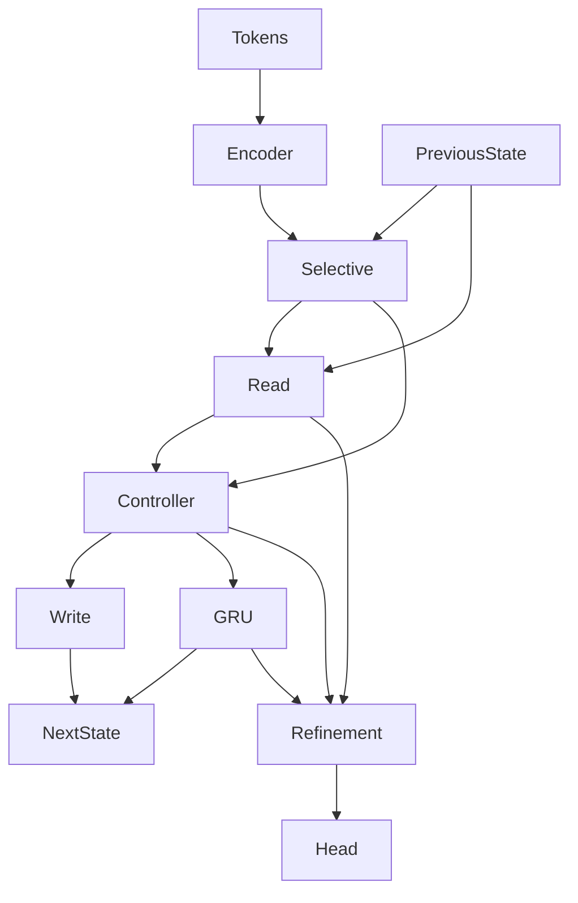

# Architecture

Token IDs enter a trainable embedding and projection. The selective gate combines each projected token with the previous slow state to produce addressing features. The fast matrix supplies a query read and a key-based prediction from the same previous state. A shared controller uses both memory streams, the value projection, and scalar diagnostics to coordinate updates. The GRU consumes the ungated query read. Retrieval strength scales the read passed to refinement.

The fast matrix and slow vector each update once per token. Refinement changes the output representation, and its intermediate values are local to the current token. Independent linear heads emit per-token classification, retrieval, regression, or next-token scores. Target masks select positions that contribute to task loss.

At batch size B, the persistent tensors have shapes [B, value_dim, key_dim] and [B, slow_state_dim]. The full-sequence API also returns per-token outputs and diagnostic tensors. Training retains activations for backpropagation through time. Bound inference working memory by using a fixed chunk size and consuming each chunk's outputs before proceeding.
